# Wine Quality — End-to-End Regression & Classification

> Generated by `python run.py all` from the UCI Wine Quality dataset
> (Cortez et al., 2009). Every number is produced by the pipeline.

## 1. Executive summary

| Task | Target | Best model | Headline metric |
| --- | --- | --- | --- |
| Regression | `quality` (3–9) | see below | RMSE + R² |
| Classification | `quality ≥ 7` | see below | ROC AUC + F1 |

- **Regression (`quality` 3–9):** `random_forest` — RMSE
  **0.660**, R² **0.421** on hold-out.
- **Classification (`quality ≥ 7`):** `random_forest` — ROC AUC
  **0.874**, F1 **0.609**.

- **Dataset:** 5,320 wines after de-duplication
  (1,359 red,
  3,961 white), 11 physicochemical measurements.
- **Class balance:** **19.0%** of wines score 7 or above.
- **Key signal:** alcohol content and volatile acidity carry most of the predictive power;
  wine colour is a strong shortcut but not a chemical explanation.

## 2. Dataset and validation

Two source files (`winequality-red.csv`, `winequality-white.csv`) are combined with a
`wine_type` tag. The validation layer checks 8 conditions —
column presence, row count, missing measurements, plausible physical ranges and the
quality domain — before anything is modelled.

## 3. Cleaning

| Step | Result |
| --- | --- |
| Rows in | 6,497 |
| Exact duplicate measurements removed | 1,177 |
| Rows out | 5,320 |
| Good-wine rate | 19.0% |

Duplicates are real repeat lab measurements, but keeping them would place the same wine
in both training and validation folds and inflate every score. They are removed once,
counts are reported per wine type, and the effect is documented rather than hidden.

## 4. Exploratory findings

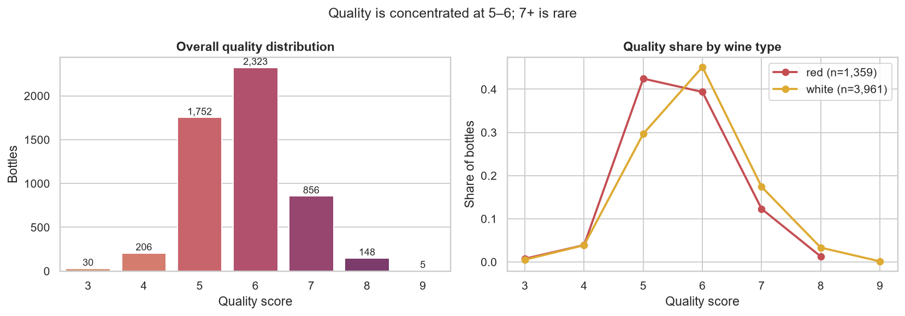

Quality is concentrated at 5–6. Scores are ordinal with hard boundaries at 3 and 9, so
treating quality as a continuous target (regression) and as a thresholded label
(classification) answer two different business questions.

### Distribution of quality scores

| Quality | Bottles |
| --- | --- |
| 3 | 30 |
| 4 | 206 |
| 5 | 1,752 |
| 6 | 2,323 |
| 7 | 856 |
| 8 | 148 |
| 9 | 5 |

| Wine type | Rows | Rated 7+ |
| --- | --- | --- |
| red | 1,359 | 13.5% |
| white | 3,961 | 20.8% |

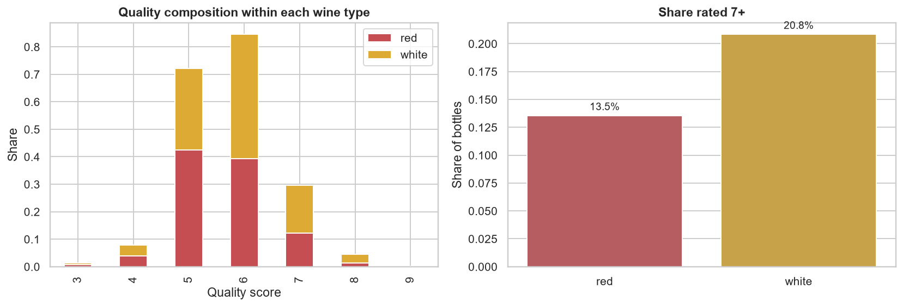

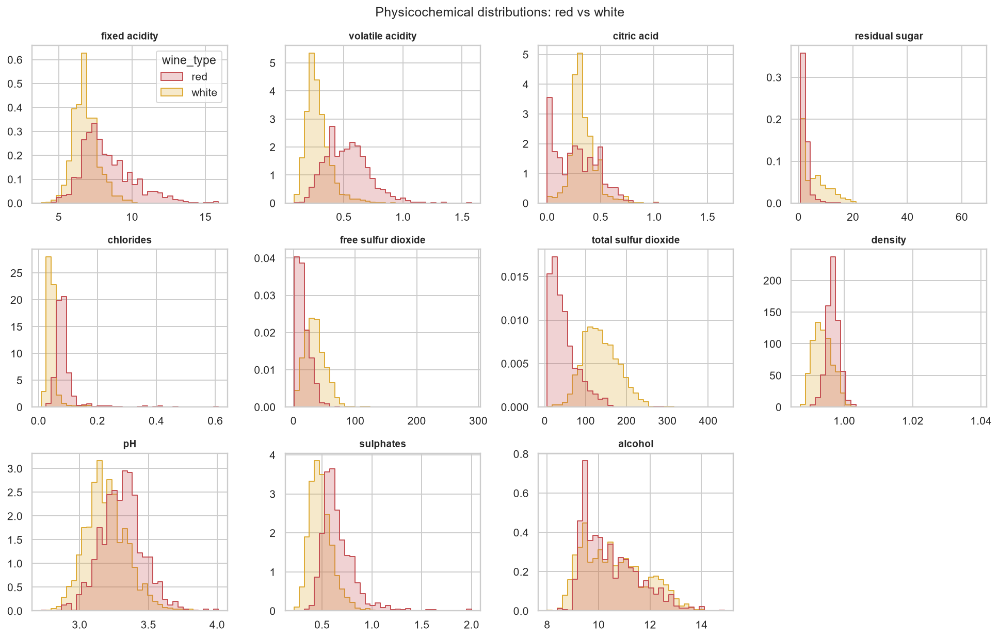

### Chemistry vs quality

| Feature | Correlation with quality |
| --- | --- |
| `alcohol` | +0.469 |
| `density` | -0.326 |
| `volatile acidity` | -0.265 |
| `chlorides` | -0.202 |
| `sulphates_alcohol` | -0.127 |
| `free_so2_ratio` | +0.124 |
| `sugar_alcohol_ratio` | -0.100 |
| `citric acid` | +0.098 |

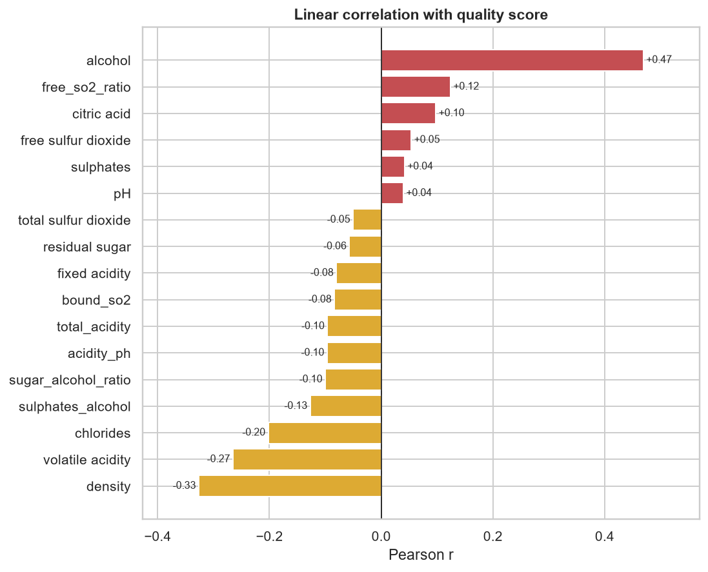

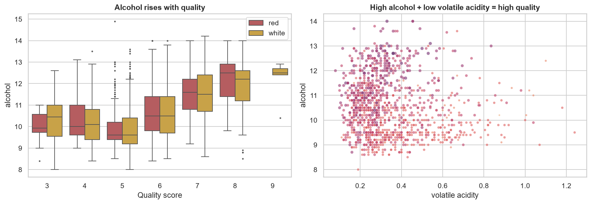

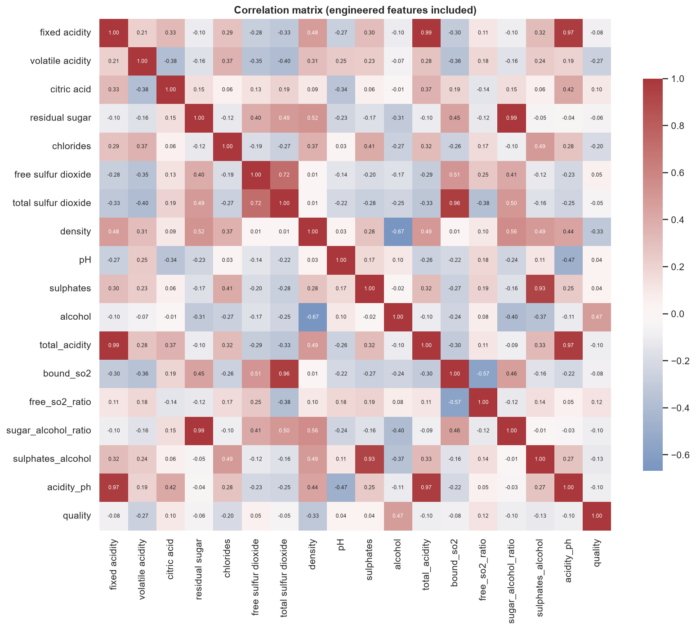

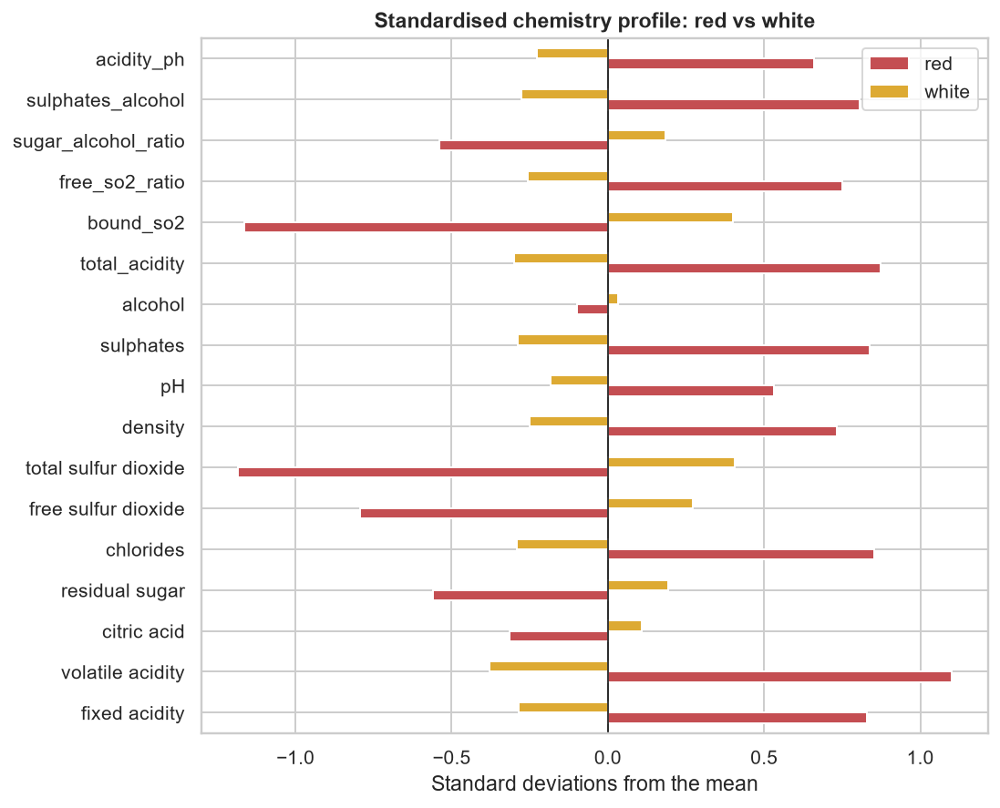

The two wine types differ sharply: white wines are sweeter, denser and lower in volatile
acidity, while reds carry more sulphates and fixed acidity. Any model that ignores wine
type will partly learn colour instead of chemistry.

## 5. Regression — predicting the quality score

### 5.1 Candidate comparison (5-fold CV)

| Model | RMSE | MAE | R² | Fit time |
| --- | --- | --- | --- | --- |
| random forest | 0.699 | 0.538 | 0.373 | 7.3s |
| gradient boosting | 0.701 | 0.546 | 0.368 | 4.0s |
| ridge | 0.733 | 0.566 | 0.309 | 0.2s |

### 5.2 Hold-out performance

| Metric | Value |
| --- | --- |
| RMSE | 0.6599 |
| MAE | 0.5085 |
| Median absolute error | 0.3989 |
| R² | 0.4208 |
| Within ±1 quality point | 88.0% |
| Within ±0.5 quality points | 59.7% |
| Baseline RMSE (predict mean) | 0.8676 |
| Improvement over baseline | 23.9% |
| Best parameters | `{"max_depth": null, "max_features": 0.5, "min_samples_leaf": 2, "n_estimators": 464}` |

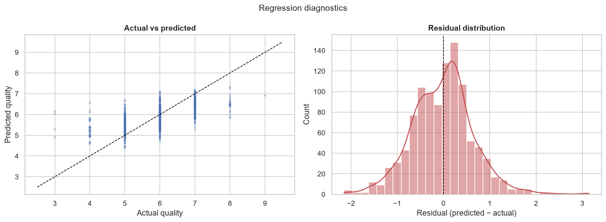

The residuals are roughly symmetric and centred on zero, but the model compresses
towards the middle: extreme scores (3, 8, 9) are systematically under-predicted because
they are rare and the loss is dominated by the 5–6 mass. That is a property of the data,
not a tuning failure.

### 5.3 Drivers

| Feature | Importance |
| --- | --- |
| `alcohol` | 0.2113 |
| `volatile acidity` | 0.0958 |
| `density` | 0.0807 |
| `free_so2_ratio` | 0.0667 |
| `free sulfur dioxide` | 0.0581 |
| `chlorides` | 0.0510 |
| `sulphates` | 0.0464 |
| `sulphates_alcohol` | 0.0463 |

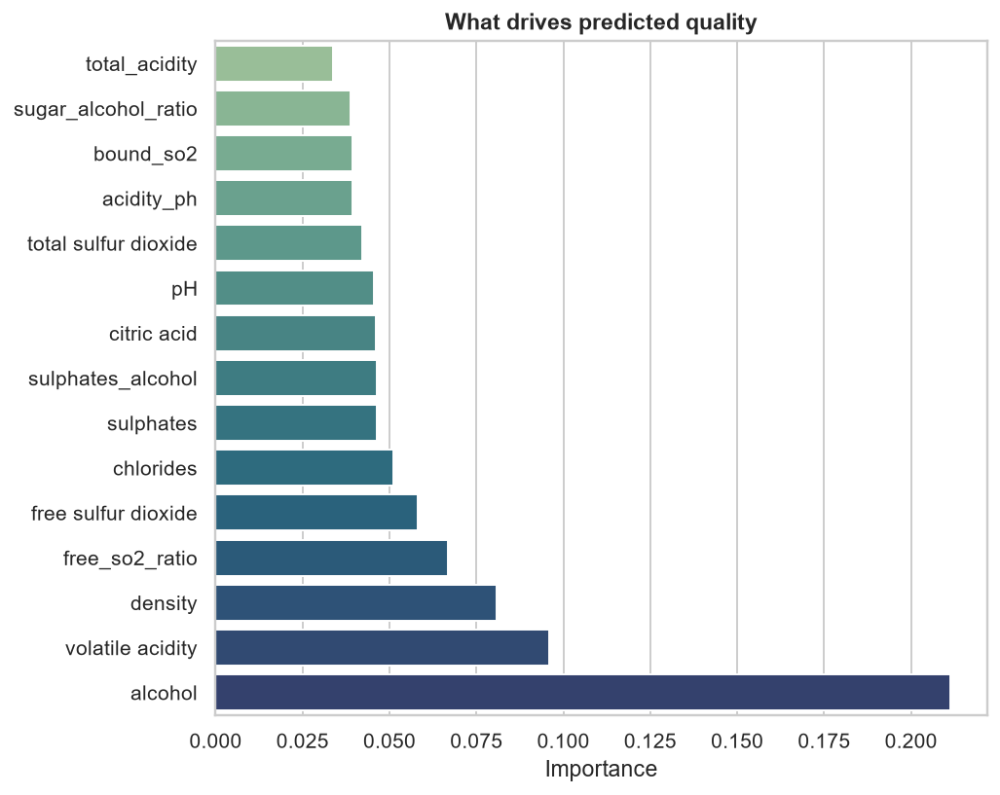

## 6. Classification — is the wine "good"?

Labels: `quality ≥ 7` → **19.0%** positive.

### 6.1 Candidate comparison (5-fold stratified CV)

| Model | ROC AUC | Avg. precision | F1 | Recall | Fit time |
| --- | --- | --- | --- | --- | --- |
| random forest | 0.850 | 0.574 | 0.509 | 0.426 | 2.9s |
| gradient boosting | 0.840 | 0.547 | 0.442 | 0.353 | 5.0s |
| logistic regression | 0.832 | 0.521 | 0.536 | 0.778 | 0.1s |

### 6.2 Hold-out performance

| Metric | Value |
| --- | --- |
| ROC AUC | 0.8735 |
| Average precision | 0.6236 |
| Accuracy | 0.8261 |
| Precision | 0.5314 |
| Recall | 0.7129 |
| F1 | 0.6089 |
| Brier score | 0.1057 |
| Threshold | 0.33 |
| True positives | 144 |
| False negatives | 58 |
| False positives | 127 |
| True negatives | 735 |

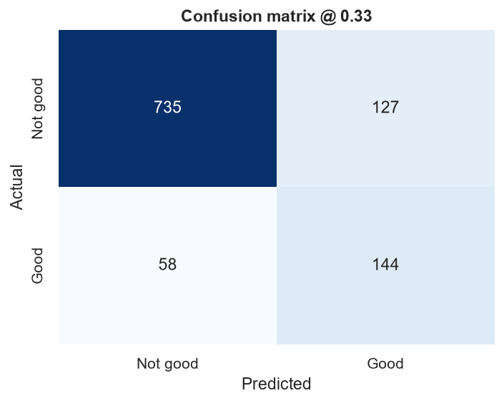

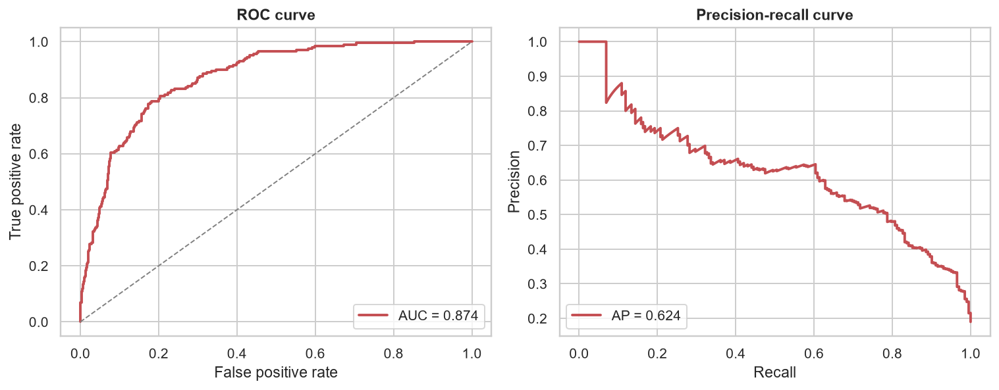

### 6.3 Operating points

| Threshold | Precision | Recall | F1 |
| --- | --- | --- | --- |
| 0.30 | 0.508 | 0.767 | 0.611 |
| 0.33 | 0.531 | 0.713 | 0.609 |
| 0.40 | 0.580 | 0.629 | 0.603 |
| 0.50 | 0.646 | 0.416 | 0.506 |
| 0.60 | 0.724 | 0.272 | 0.396 |

For a winery screening a large batch, recall matters more than precision (missing a good
wine is costly); for a premium single-bottle check, precision dominates. The threshold is
exposed as a decision, not baked in.

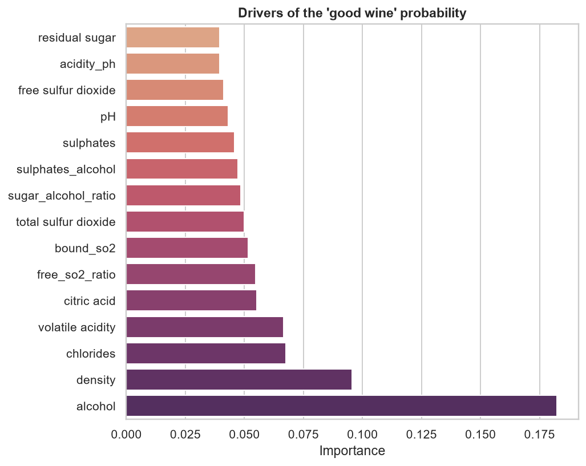

## 7. Interpretation

1. **Alcohol** is the strongest single correlate of quality (r ≈
   +0.47),
   followed by **volatile acidity** (negative) and **sulphates**.
2. **Density and residual sugar** are largely proxies for wine style; they separate
   red from white more than they separate good from bad.
3. **Total vs free SO₂** behaves as expected: free sulphur dioxide protects the wine,
   but the ratio — not the absolute level — is what distinguishes quality tiers.
4. The regression ceiling is real: physicochemical measurements explain roughly half the
   variance in expert scores, so sensory panel effects dominate the rest.

## 8. Limitations

- Expert scores are subjective and highly discretised; R² is capped by rater noise.
- No vintage, region or grape-variety metadata — the model cannot generalise to
  unmeasured styles.
- Duplicate removal changes the effective sample size; scores are not directly
  comparable with papers that keep duplicates.
- Observational data: no causal claim about which chemistry change improves a wine.

## 9. Reproducing

```bash
pip install -r requirements.txt
python run.py all
```

Regenerates every figure, `reports/metrics.json`, this report and the model card.
